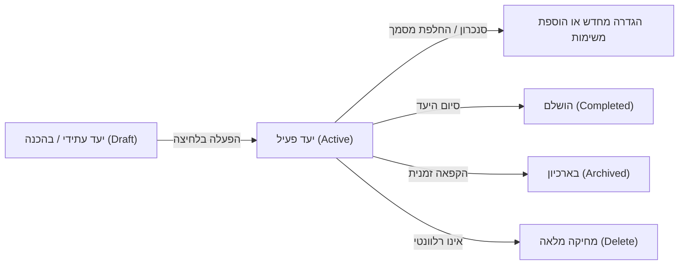
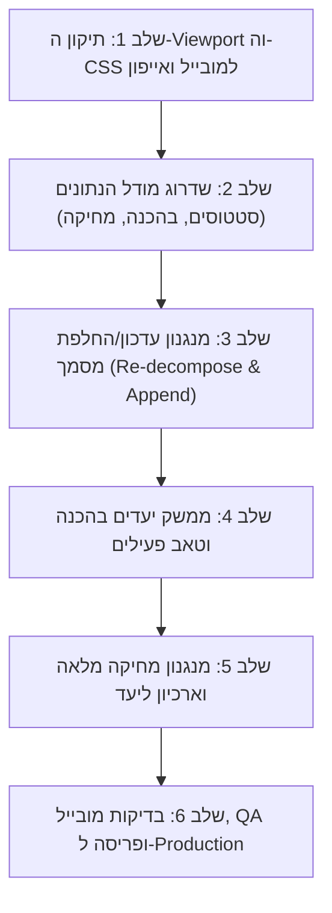

# תוכנית עבודה מקיפה: שדרוג מסך הגדרת יעדים (Goals & Learning Programs Plan)

> [!IMPORTANT]
> מסמך תוכנית זה מגדיר את הארכיטקטורה, חוויית המשתמש והשלבים המעשיים לשדרוג כולל של מסך הגדרת היעדים והתוכניות באפליקציה, במענה מדויק לכל הפערים שזוהו.

---

## 1. תקציר מנהלים ומטרות התוכנית

מסך הגדרת היעדים מהווה את מרכז הפיקוד של האפליקציה לניהול שאיפות אישיות, מקצועיות ותוכניות למידה מבוססות Google Drive ו-NotebookLM. 
מטרת התוכנית היא להפוך את ניהול היעדים לגמיש, מודולרי ומותאם באופן מושלם למכשירי מובייל (בדגש על iOS ואייפון), תוך מתן שליטה מלאה במחזור חיי היעד – מרעיון בהכנה ועד ביצוע שוטף או מחיקה.

---

## 2. פירוט היכולות הנדרשות ופתרונות ארכיטקטוניים

### 2.1 יכולת 1: עריכת יעד והגדרה מחדש / הוספת משימות בלחיצת כפתור

#### המצב הקיים:
לאחר שיעד או מחברת נוצרו, כדי לעדכן משימות ממסמך חדש נדרש להוסיף משימות ידנית אחת-אחת או ליצור מחברת חדשה מאפס.

#### הפתרון המתוכנן:
* **כפתור "עדכון משימות ממסמך" בתוך מסך היעד:**
  לחיצה על הכפתור פותחת דיאלוג עדכון מהיר שבו ניתן:
  1. לציין שם קובץ חדש ב-Google Drive.
  2. להזין קישור למסמך Google Docs חדש.
  3. להדביק טקסט תוכנית מעודכן ישירות מ-NotebookLM.
* **בחירת אופן העדכון (Update Mode):**
  * **החלפה מלאה (Re-decompose & Replace):** מנקה את כל משימות היעד שטרם הושלמו ומחליפה אותן במשימות שחולצו מהמסמך החדש (משימות שכבר סומנו כהושלמו נשמרות לצורך היסטוריה ומעקב!).
  * **הוספה בלבד (Append / Merge):** שומרת על כל המשימות הקיימות ומוסיפה אליהן את המשימות החדשות שנוספו במסמך.
* **מנגנון חילוץ חכם (Smart Plan Parser):**
  זיהוי אוטומטי של שלבים, ימים, משכי זמן (דקות/שעות) וכותרות מתוך המסמך, עם תצוגה מקדימה לפני אישור.

---

### 2.2 יכולת 2: מחיקה מלאה וארכוב של יעד ראשי שאינו רלוונטי

#### המצב הקיים:
בחלק מהיעדים (כגון תוכנית ברירת המחדל Assertive Practice) כפתור המחיקה הוגבל או שהמחיקה לא ניקתה את כל המשימות שנזרקו לבנק או ללוח השבועי, מה שהשאיר "שאריות" של משימות יתומות.

#### הפתרון המתוכנן:
* **הסרת כל חסימת מחיקה:** המשתמשת היא בעלת השליטה המלאה על כל יעד באפליקציה, ללא יעדים "נעולים".
* **אפשרויות ניקוי במחיקה:**
  בעת לחיצה על אייקון המחיקה (`Trash2`), יופיע דיאלוג אישור המציע:
  1. **מחיקה כוללת (Clean Delete):** מחיקת היעד יחד עם כל המשימות שנוצרו ממנו (בסדר היום, בבנק היעדים ובלוח השבועי).
  2. **מחיקת היעד בלבד:** השארת המשימות שכבר שובצו בלוח כמשימות רגילות.
* **יכולת ארכוב (Archive / Mute):**
  כפתור "העבר לארכיון" עבור יעדים שאינם פעילים כרגע אך המשתמשת רוצה לשמור את ההיסטוריה שלהם לעתיד, מבלי שיופיעו ברשימת היעדים השוטפת.

---

### 2.3 יכולת 3: הגדרת יעדים עתידיים שאינם מופיעים במסך השוטף ("יעד בהכנה")

#### המצב הקיים:
כל יעד שמוגדר מופיע מיד ברשימת היעדים הפעילים ודורש שיבוץ, מה שיוצר עומס קוגניטיבי על המשתמשת כשיש יעדים שמתכננים רק לחודש הבא או לרבעון הבא.

#### הפתרון המתוכנן:
* **שדה סטטוס מובנה ליעד (Goal Lifecycle Status):**
  * `in_preparation` (בהכנה / עתידי)
  * `active` (פעיל – יעד שרץ כרגע בסדר היום)
  * `paused` (מושהה)
  * `completed` (הושלם)
* **הפרדה ויזואלית מוחלטת:**
  * **המסך הראשי של היעדים:** יציג כברירת מחדל אך ורק יעדים בסטטוס `active`.
  * **טאב / מגירה ייעודית: "יעדים בהכנה ותוכניות עתידיות (Drafts)":**
    כאן ניתן להגדיר יעדים, לחבר קבצים, לערוך תוכניות ולרשום רעיונות מבלי שהם ישפיעו על הלוח השבועי או על בנק היעדים הפעיל.
* **הפעלה בקליק אחד (Activate Goal):**
  כאשר מגיע הזמן להתחיל את היעד, לחיצה על כפתור "הפעל יעד כעת 🚀" תעביר אותו לסטטוס `active` ותציע פיזור שלבים לאורך השבוע.

---

### 2.4 יכולת 4: תיקון תצוגת אייפון ומובייל – קיבוע המסך ומניעת גלילה לצדדים

#### המצב הקיים:
באייפון ובדפדפני מובייל WebKit/Safari, תוכן רחב (כמו טבלאות, כפתורים בשורה אופקית, או שדות input ללא `max-width`) גורם ל-`overflow-x` ולזליגת רוחב, מה שמאפשר גלילה רוחבית מעצבנת ("דפים צפים").

#### הפתרון המתוכנן:
1. **קיבוע קונטיינר ה-Modal והמסך:**
   * הגדרת `overflow-x-hidden` ו-`w-full max-w-full` על מעטפת המודאל ועל ה-Root layout.
   * שימוש ב-`touch-action: pan-y` למניעת מחוות החלקה אופקיות לא רצויות.
2. **התאמה מלאה ל-iOS Safe Area:**
   * שימוש במשתני מערכת: `padding-bottom: env(safe-area-inset-bottom)` ו-`padding-top: env(safe-area-inset-top)`.
3. **שבירת שורות רספונסיבית (Mobile-First Card Layout):**
   * שימוש ב-`flex-wrap` ו-`min-w-0` על כל כרטיסיות המשימות, כך ששום שורת כפתורים לא תחרוג מרוחב המסך.
   * העברת כפתורי הפעולה לשורת כלים תחתונה מרווחת בכרטיסייה, במקום דחיסתם לצד כותרת השלב.
4. **גודל אזורי מגע (Touch Targets):**
   * כל כפתור יהיה בגובה מינימלי של 40–44 פיקסלים, עם ריווח מותאם לאצבע.

---

## 3. יכולות מומלצות נוספות לשיפור נוחות השימוש והמעקב

מעבר ל-4 נקודות הליבה, מומלץ לשלב את היכולות הבאות:

| יכולת משודרגת | תיאור ותועלת למשתמשת |
| :--- | :--- |
| **סנכרון דו-כיווני מול Google Drive** | אם מסמך התוכנית ב-Drive עודכן על ידי המשתמשת מחוץ לאפליקציה, כפתור "בדוק שינויים במסמך" יזהה עדכונים ויעדכן את השלבים אוטומטית. |
| **מפת דרכים ויזואלית (Milestone Roadmap)** | תצוגת ציר זמן פשוטה המציגה באיזה שלב בתוכנית המשתמשת נמצאת כרגע, מה הושלם ומה היעדים הבאים. |
| **התראת "יעד ללא תנועה" (Dormant Goal Alert)** | חיווי עדין כאשר יעד פעיל לא תורגל מעל 5 ימים, עם הצעה להעבירו להשהיה או לשבץ שלב קצר להיום. |
| **זמן מוערך שבועי (Weekly Time Budget)** | חישוב סך הדקות שתוכננו לשבוע עבור כל יעד (למשל: "יעד מוזיקה קלאסית: 45 דק' השבוע"), כדי למנוע עומס יתר. |
| **ייצוא סיכום התקדמות (Export Progress)** | כפתור ייצוא דוח קצר (טקסט או PDF) עם רשימת כל ההישגים והשלבים שבוצעו ביעד. |

---

## 4. תוכנית עבודה ושלבי ביצוע הנדסיים

### פירוט שלבי העבודה:

#### שלב 1: קיבוע תצוגת מובייל ומניעת גלילה אופקית (CSS & iOS Fix)
* עדכון `index.html` ו-`src/index.css`: הוספת חוקי `overflow-x: hidden`, `overscroll-behavior-x: none`, תמיכה ב-iOS viewport-fit.
* עדכון מעטפת `GoalsTimelineModal.tsx`, `NotebookManagerModal.tsx` ו-`DailyProcess.tsx`: וידוא שכל אלמנט מוגבל ל-`max-w-full` ורוחב של `100vw`.

#### שלב 2: עדכון מודל הנתונים ו-TypeScript Types
* הוספת `status: 'active' | 'in_preparation' | 'archived' | 'completed'` למודל `LearningNotebook` ו-`Task`.
* הוספת פונקציות שמירה ואחזור עבור יעדים בהכנה ויעדים בארכיון.

#### שלב 3: מנגנון עריכה, החלפת מסמך והוספת משימות
* פיתוח קומפוננטת `ReDecomposeModal` / הרחבת מודל העריכה הקיים.
* מתן אפשרות למשתמשת לבחור בין "החלפה מלאה של משימות עתידיות" לבין "הוספת משימות חדשות על הקיימות".
* שמירה קפדנית על משימות שכבר בוצעו בעבר.

#### שלב 4: ממשק יעדים בהכנה (Incubator / Future Goals)
* הוספת טאב / פילטר בראש המסך: `יעדים פעילים` | `בהכנה ותכנון עתידי` | `ארכיון`.
* עיצוב כרטיסיית יעד בהכנה: רקע מעודן, סימון טיוטה, וכפתור בולט: `הפעל יעד זה כעת 🚀`.

#### שלב 5: מחיקה גורפת וארכוב
* הוספת פונקציית `deleteNotebookWithTasks(notebookId, purgeTasks: boolean)`.
* הסרת כל מגבלה על מחיקת תוכנית ברירת המחדל.
* הוספת דיאלוג אישור עם הסבר ברור על כמות המשימות שיימחקו.

#### שלב 6: בדיקות, אימות ופריסה ל-GitHub Pages
* בדיקה ייעודית במכשירי iOS / סימולטור מובייל לאימות נעילת הגלילה האופקית.
* הרצת בדיקות Build מלאות (`npm run build`).
* פריסה אוטומטית ל-Production דרך GitHub Pages.

---

> תוכנית זו מאושרת ליישום מידי ומספקת פתרון הוליסטי לכל הדרישות שהועלו.
