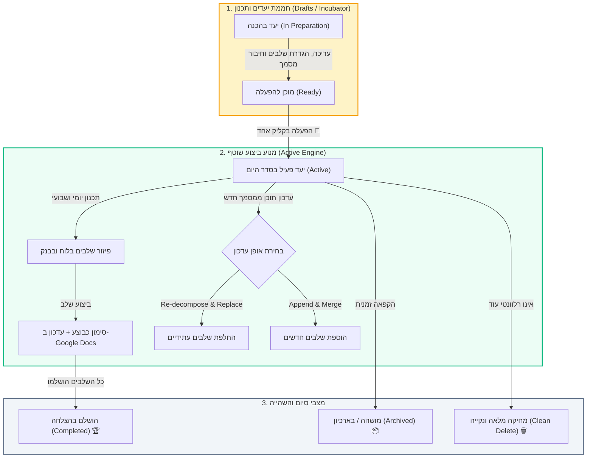
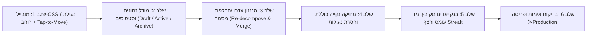

# תוכנית עבודה מקיפה ואחודה: שדרוג מסך הגדרת יעדים ותוכניות למידה
## (Unified Goals & Learning Programs Master Plan)

> [!IMPORTANT]
> מסמך תוכנית זה מאחד את כל השיפורים והדרישות מתוך קובץ התוכנית החדש, יחד עם היכולות שפותחו באפליקציה (שירותי Google Drive, מסמכי Google Docs, עבודה עם מחברות למידה ב-NotebookLM, ולוח ה-Timeline) וכל הצעות השדרוג לחוויית משתמש ופרודוקטיביות. המסמך מהווה את המקור המוסמך והבלעדי (Single Source of Truth) לפיתוח מסך היעדים.

---

## 1. ארכיטקטורת מחזור חיי יעד (Goal Lifecycle Architecture)

היעדים באפליקציה מנוהלים כעת במודל מחזור חיים שלם, המאפשר הפרדה בין שלב החשיבה והתכנון לבין שלב הביצוע היומיומי:

---

## 2. איחוד כלל היכולות והשיפורים (Feature Matrix)

התוכנית מאחדת 6 צירי שיפור מרכזיים:

| ציר | נושא השיפור | מקור | תועלת מרכזית למשתמשת |
| :--- | :--- | :--- | :--- |
| **ציר 1** | **עריכה, החלפת מסמך והגדרה מחדש** | קובץ התוכנית | עדכון שלבים ממסמך Google Docs חדש או הדבקה מ-NotebookLM מבלי ליצור יעד מאפס, תוך שמירה על שלבים שכבר בוצעו. |
| **ציר 2** | **מחיקה מלאה, ארכוב והסרת נעילות** | קובץ התוכנית | הסרת כל מגבלת מחיקה (כולל תוכניות ברירת מחדל), עם אפשרות למחיקה נקייה של כל המשימות שנזרקו ללוח או לבנק. |
| **ציר 3** | **יעדים בהכנה (Drafts / Incubator)** | קובץ התוכנית | טאב ייעודי ליעדים עתידיים שאינם מעמיסים על לוח השבוע עד לרגע הפעלתם. |
| **ציר 4** | **התאמה מושלמת למובייל ואייפון (iOS PWA)** | קובץ התוכנית + שיפורי UX | מניעת גלילה רוחבית (`overflow-x-hidden`), תמיכה ב-Safe Area, ומנגנון שיבוץ מהיר בלחיצה (Tap-to-Reschedule) כתחליף מגע ל-Drag & Drop. |
| **ציר 5** | **תצוגת משימה קומפקטית / מורחבת (Chevron Toggle)** | שיפורי UX קודמים | קריאה נקייה של סדר היום (נושא וצ'קבוקס בלבד) עם אפשרות להרחיב בלחיצה לקבלת קישורי Docs, תקציר שלב, ואבן דרך. |
| **ציר 6** | **ניהול עומס זמנים, בנק משימות מתקדם ורצף התמדה** | שיפורי UX והתפתחות אישית | חלוקת בנק היעדים לאקורדיונים לפי נושאים, תקציב עומס זמנים יומי/שבועי (מד קיבולת למניעת שחיקה), ומונה רצף התמדה (Streak 🔥). |

---

## 3. פירוט מעמיק של פתרונות המערכת

### 3.1 עריכה, פירוק מחדש והחלפת מסמך (Re-decompose & Merge Engine)
* **דיאלוג עדכון חכם ביעד פעיל:**
  * כפתור *"עדכון שלבים ממסמך / NotebookLM"* בתוך כרטיסיית היעד.
  * המשתמשת יכולה להדביק טקסט מעודכן, להזין לינק למסמך Docs, או לבחור קובץ מ-Google Drive.
* **בחירת אופן העדכון (Update Strategy):**
  1. **החלפה מלאה (Replace Future Stages):** מסירה את כל השלבים העתידיים שטרם בוצעו ומייצרת שלבים חדשים מהמסמך. **כל שלב שכבר סומן כהושלם נשמר בקפידה** לצורך היסטוריה ומעקב סטטיסטי.
  2. **הוספה ומיזוג (Append & Merge):** משאירה את כל השלבים הקיימים ומוסיפה רק את השלבים החדשים שנוספו במסמך.
* **מנגנון חילוץ זמנים ואבני דרך (Smart Parser):**
  * זיהוי אוטומטי של זמנים ומשכים בעברית ובאנגלית (`30 דק'`, `שעה וחצי`, `45m`), קישורים, וכותרות שלבים.

---

### 3.2 מחיקה גורפת, ארכוב וחופש פעולה מלא
* **הסרת חסימות:** כל יעד ומחברת באפליקציה (לרבות תוכניות הדגמה מובנות) ניתנים למחיקה מלאה או לעריכה.
* **דיאלוג מחיקה דו-שלבי:**
  * **מחיקה כוללת (Clean Purge):** מוחקת את היעד יחד עם כל המשימות המשויכות אליו בסדר היום, בלוח השבועי ובבנק המשימות.
  * **מחיקת מסגרת היעד בלבד:** משאירה את המשימות שכבר שובצו בלוח כמשימות עצמאיות.
* **מצב ארכיון (Archive):**
  * אפשרות להעביר יעד לארכיון. היעד אינו נמחק אך מוסתר מלוחות הזמנים ואינו מייצר משימות שבועיות, וניתן להחזירו לפעילות בכל עת.

---

### 3.3 יעדים בהכנה וחממת רעיונות (Drafts & Incubator)
* **סטטוס יעד מורחב (`GoalLifecycleStatus`):**
  * `in_preparation` (בהכנה / טיוטה עתידית)
  * `active` (פעיל ושוטף)
  * `paused` (מושהה זמנית)
  * `completed` (הושלם במלואו)
  * `archived` (בארכיון)
* **תצוגת טאבים מופרדת:**
  * **טאב 1: יעדים פעילים (Active Programs):** רק מה שרץ ומתוכנן לביצוע השבוע.
  * **טאב 2: חממת יעדים בהכנה (Incubator / Future):** מרחב תכנון שקט לרעיונות עתידיים, ללא הפרעה ללוח השוטף.
  * **טאב 3: ארכיון והיסטוריה (Archive):** יעדים שהסתיימו או הוקפאו.
* **הפעלה בקליק אחד (One-Click Activation):**
  * כפתור בולט: *"הפעל יעד זה כעת 🚀"* המעביר את היעד למצב פעיל ומציע פיזור שלבים אינטליגנטי לשבוע הקרוב.

---

### 3.4 חוויית מובייל ו-iOS PWA: קיבוע תצוגה ומחוות מגע
* **נעילת גלילה אופקית (Viewport Strict Lock):**
  * החלת `overflow-x-hidden`, `max-w-full`, ו-`touch-action: pan-y` על מעטפת המודאלים והמסך הראשי למניעת תופעת "דפים צפים" או גלילה רוחבית אקראית באייפון.
  * התאמה ל-iOS Safe Area עם `env(safe-area-inset-bottom)`.
* **שיבוץ מהיר בלחיצה (Tap-to-Reschedule Action Sheet):**
  * במקום להסתמך רק על גרירה (Drag & Drop) שמיועדת לעכבר במחשב, בכל כרטיסיית יעד מתווסף אייקון שיבוץ מהיר הפותח תפריט נגיש באגודל:
    * 📌 **שבץ להיום**
    * 🌅 **שבץ למחר**
    * 📅 **בחר יום בשבוע (א'-ש')**
    * 📥 **החזר לבנק היעדים**

---

### 3.5 תצוגת משימה קומפקטית / מורחבת (Compact vs. Expanded Mode)
* **מצב קומפקטי (Default Clean Mode):**
  * המשימה מציגה רק נושא/כותרת, שעה/משך זמן וצ'קבוקס – סריקה חלקה ומהירה של היום ללא עומס טקסטואלי.
* **אייקון פתיחה/סגירה (Chevron Toggle):**
  * לחיצה על החץ חושפת את התוכן המלא:
    * תקציר השלב ופיסקת הנחיה מעשית מתוך ה-Google Doc / NotebookLM.
    * כפתור קישור ישיר למסמך המקורי או לשיחת וידאו.
    * תגית אבן דרך ומשך זמן מדויק.
    * כפתורי עריכה ושיבוץ מהיר.

---

### 3.6 בנק יעדים משודרג, תקציב עומס ורצף התמדה
* **בנק משימות מאורגן לפי נושאים (Grouped Backlog):**
  * חלוקת בנק היעדים לאקורדיונים מתקפלים לפי תחומי למידה (לדוגמה: *Machine Learning*, *GoogleLM*, *ספרדית*).
  * סינון מהיר לפי זמנים: **"יעדים מהירים (עד 30 דק')"** לעומת **"יעדי עומק (שעה+)"**.
  * תיבת חיפוש מהיר לאיתור יעד ספציפי בבנק.
* **מד עומס ותקציב זמן יומי ושבועי (Daily Capacity Meter):**
  * הגדרת תקציב למידה יומי מומלץ (למשל 60 דק').
  * הצגת מד עומס עדין המציג זמן מתוכנן מול התקציב, ומתריע בעדינות בעת עומס יתר כדי לשמור על קצב בריא לאורך זמן.
* **רצף התמדה יומי (Goal Streak 🔥):**
  * מעקב אחר ימים רצופים בהם בוצע לפחות יעד התפתחות אחד.
  * שילוב עם חגיגת ה-Confetti המובנית להגברת המוטיבציה.

---

## 4. תוכנית עבודה מודולרית ליישום (Phase by Phase)

### פירוט שלבי היישום:

#### שלב 1: חוויית מובייל ו-CSS – נעילת רוחב ושיבוץ מהיר בטאץ' [V] הושלם במלואו ונבדק באוויר ✅
1. עדכון מעטפת `GoalsTimelineModal.tsx`, `NotebookManagerModal.tsx` ו-`DailyProcess.tsx`:
   * הוספת `overflow-x-hidden`, `max-w-full`, ומניעת זליגת תוכן ב-Safari/iOS (`touch-action: pan-y`, בידוד שורות כפתורים עם `shrink-0`).
2. הוספת רכיבי שיבוץ מהירים בלחיצה: כפתורי "להיום", "לבנק" (העברה מיידית ל-Backlog) ושיבוץ לפי תאריך בכל כרטיסיית שלב ומשימה.

#### שלב 2: מודל נתונים וניהול מחזור חיי היעד (Lifecycle & Statuses) [V] הושלם במלואו ונבדק באוויר ✅
1. הרחבת הטיפוסים ב-`types.ts`:
   * `status: 'active' | 'in_preparation' | 'archived' | 'completed'`.
2. הוספת טאבים במסך הגדרת היעדים ובמחברות הלמידה:
   * **יעדים פעילים** | **יעדים בהכנה (חממה / טיוטות)** | **ארכיון**.
3. כפתור הפעלה מהיר: מעבר מטיוטה ליעד פעיל עם הצעה לפיזור שלבים.

#### שלב 3: מנגנון עריכה, החלפת מסמך ופירוק מחדש (Re-decompose Engine) [V] הושלם במלואו ונבדק באוויר ✅
1. מודאל עדכון ופירוק מחדש:
   * אפשרות לעדכן יעד באמצעות קובץ Drive חדש, קישור Docs או הדבקת טקסט מ-NotebookLM.
   * בחירה בין *החלפת שלבים עתידיים בלבד* לבין *הוספת שלבים חדשים (Append & Merge)*.
   * שימור מלא של שלבים שכבר הושלמו בעבר.

#### שלב 4: מחיקה נקייה וגורפת והסרת הגבלות [V] הושלם במלואו ונבדק באוויר ✅
1. הסרת כל תנאי החוסם מחיקת תוכניות מובנות — שליטה מלאה למשתמשת.
2. פונקציית מחיקה נקייה דו-שלבית: מחיקת היעד יחד עם מחיקת כל משימותיו בסדר היום, בלוח השבועי ובבנק המשימות.

#### שלב 5: שכלול בנק היעדים, מד עומס זמנים ורצף התמדה [V] הושלם במלואו ונבדק באוויר ✅
1. קיבוץ בנק היעדים לפי אבני דרך עם אקורדיון מתקפל.
2. פילטר מהיר לפי משך זמן (קצר / עמוק) ותיבת חיפוש בבנק.
3. מד עומס זמנים יומי ושבועי (סך דקות מול תקציב מומלץ).
4. רכיב Goal Streak למוטיבציה והתמדה יומית.

#### שלב 6: בדיקות איכות מקיפות ופריסה [V] הושלם במלואו ונבדק באוויר ✅
1. הרצת `npm run build` ובדיקת תאימות טיפוסים מלאה (0 שגיאות).
2. בדיקה במכשירי iOS לווידוא נעילת רוחב המסך ותקינות תפריטי המגע.
3. פריסה אוטומטית לענן דרך GitHub Actions לכתובת האפליקציה החיה ב-GitHub Pages.

---

## 5. תוספות שנבנו והוטמעו (שלבי הרחבה בגרסה 1.7) 🚀

### 5.1 מנגנון ימי הולדת מיומן Google ואנשי קשר Google Contacts
* **סנכרון רחב (60 ימים קדימה):** חילוץ ימי הולדת מיומן אנשי הקשר ומכלל יומני Google המשניים.
* **זיהוי שמות עברי ולועזי רחב:** תמיכה מלאה בהטיות כגון `יומולדת`, `יום הולדת`, `יומהולדת`, `יום הולדתו/ה`, `חגיגת יום הולדת`, `Birthday`, `Bday`.
* **מחולל ברכות אישי (5 נוסחים עשירים):** כפתור **"ניסוח נוסף 🔄"** המרענן את הברכה ישירות באותו המסך ללא פתיחת מודאל עריכה.
* **מרכז ימי הולדת וברכות ייעודי (`BirthdaysModal.tsx`):** ספירה לאחור ("בעוד שבועיים"), ניווט בלחיצה אחת לתאריך האירוע בלוח, העתקה ללוח ושליחה ישירה לוואטסאפ (`wa.me`).

### 5.2 חידוש חיבור Google OAuth בלחיצה אחת וניהול אבטחה שקוף
* **One-Click Reconnect:** בעת פקיעת טוקן (60 דק'), הכפתור בראש המסך הופך לכפתור ענבר בולט **"חדש חיבור"** הפותח הרשאה מסונכרנת מיידית במקום התראת שגיאה אדומה.
* **מודאל אבטחה והתנתקות מקיף (`SecurityDisconnectModal.tsx`):** שקיפות על מקום שמירת הנתונים, מחיקת נתונים מקומית מאובטחת, וביטול הרשאה רשמי בשרת Google (`google.accounts.oauth2.revoke`).

### 5.3 שיפורי מובייל וזרימת עבודה במחברות הלמידה (NotebookLM)
* **כפתור "לבנק":** עדכון מיידי של סטטוס השלב ל-`בבנק היעדים ✓` והפיכת הכפתור ל-`בבנק ✓` מוזהב עם תגית חיווי מיידית.
* **הפרדת כפתורים מלאה במובייל:** בידוד כפתורי השיבוץ מכפתורי העריכה והמחיקה (`✏️` / `🗑️`) למניעת חפיפה במסכים צרים.

---

> [!TIP]
> תוכנית אחודה זו פותרת באופן שורשי הן את הארכיטקטורה של ניהול היעדים והן את חוויית המשתמש במובייל ובמחשב. כל שיפור בנוי באופן מודולרי וניתן ליישום צעד-אחר-צעד.
